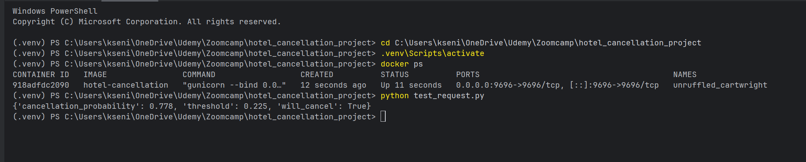

# Hotel booking cancellation prediction

Midterm project for the [DataTalks.Club Machine Learning Zoomcamp](https://github.com/DataTalksClub/machine-learning-zoomcamp).

## Problem

Hotels lose money when a guest cancels at the last moment: the room stays empty. If the hotel knew in advance which bookings are likely to be cancelled, it could, for example, ask for a deposit, send a reminder or plan overbooking more carefully.

The goal of this project is a binary classifier that predicts, **using only information known at the time of booking**, whether a booking will be cancelled (`is_canceled = 1`). The model is served as a web service that returns the cancellation probability for one booking.

## Data

Hotel Booking Demand dataset (Antonio, Almeida & Nunes, 2019, *Data in Brief*): 119,390 bookings of a city hotel and a resort hotel in Portugal, arrivals from July 2015 to August 2017.

The notebook and `train.py` download the CSV directly from this URL, so nothing has to be downloaded by hand:

```
https://raw.githubusercontent.com/rfordatascience/tidytuesday/main/data/2020/2020-02-11/hotels.csv
```

(TidyTuesday copy of the dataset, accessed 6 November 2026.)

## Repository content

| File | Description |
|---|---|
| `midterm_project.ipynb` | Data cleaning, EDA, feature importance analysis, model selection with cross-validation and hyperparameter tuning, final evaluation |
| `train.py` | Trains the final model and saves it to `model.joblib` |
| `predict.py` | Flask web service that loads the model and serves predictions |
| `test_request.py` | Sends an example booking to the running service |
| `requirements.txt` | Python dependencies of the training script and the service |
| `Dockerfile` | Builds an image with the trained model and the service |
| `docs/service_demo.png` | Screenshot of the service running in Docker and answering a request |

`model.joblib` is created by `train.py` and is not needed in the repository.

## What was done

**Data cleaning** (details and reasons are in the notebook):
- removed `company` (mostly empty); `agent` was replaced with a yes/no feature `has_agent`
- filled missing `country` with `Unknown` and missing `children` with 0
- removed about 32,000 exact duplicate rows, bookings with no guests, and bookings with an invalid or extreme price (`adr`)
- removed columns that are **not known at booking time** and would leak the target (`reservation_status`, `reservation_status_date`, `assigned_room_type`, `booking_changes`, `required_car_parking_spaces`)
- rare countries (fewer than 500 bookings in the training data) are grouped as `other`

After cleaning, there are about 87,000 bookings and 27% of them are cancelled.

**Validation.** The cancellation rate changes over time (about 25% in the training period, 35% in the test period), so a random split would be too optimistic. The data is split by arrival date: bookings arriving before 1 June 2017 are used for training and model selection (time-series cross-validation), and June to August 2017 (13,122 bookings, 35.2% cancelled) is the test set.

**Models.** Dummy classifier, logistic regression (baseline and grid search), random forest (random search) and gradient boosting (`HistGradientBoostingClassifier`, random search). Metric: ROC AUC.

| Model | Tuning | CV ROC AUC |
|---|---|---|
| Dummy (overall rate) | none | 0.500 |
| Logistic regression | default parameters | 0.760 |
| Logistic regression | grid search | 0.761 |
| Random forest | random search | 0.782 |
| Gradient boosting | random search | 0.795 |

Gradient boosting was selected as the final model.

**Final result on the test set.** ROC AUC 0.784. The decision threshold was chosen on a validation period inside the training data (March to May 2017) as the highest threshold that finds at least 70% of cancellations; it is 0.226.

| Threshold | Precision | Recall | F1 |
|---|---|---|---|
| 0.5 (default) | 0.64 | 0.44 | 0.52 |
| 0.226 (chosen) | 0.55 | 0.75 | 0.63 |

The lower threshold finds 75% of the cancellations, at the cost of more false alarms. The best threshold in practice depends on the real cost of each type of error.

`train.py` reproduces these results up to small random differences (ROC AUC within about 0.002).

## How to run

Python 3.13 is recommended (the Docker image uses it).

### 1. Install dependencies

```bash
python -m venv .venv
# Windows:  .venv\Scripts\activate
# Linux/Mac: source .venv/bin/activate
pip install -r requirements.txt
```

To run the notebook you also need `pip install matplotlib jupyter`.

On Windows, `gunicorn` (used in Docker) cannot run, but the service starts with `python predict.py`. If `pip install` fails on `gunicorn`, install the rest with `pip install pandas scikit-learn joblib flask requests`.

### 2. Train the model

```bash
python train.py
```

This downloads the data, trains the model and creates `model.joblib` (it takes about a minute). It prints the chosen threshold and the test ROC AUC.

### 3. Run the service

```bash
python predict.py
```

The service listens on `http://localhost:9696`. In a second terminal:

```bash
python test_request.py
```

Example response:

```json
{"cancellation_probability": 0.778, "threshold": 0.225, "will_cancel": true}
```

The endpoint is `POST /predict` with one booking as JSON (all 23 fields are required, see `test_request.py` for an example). `GET /health` checks that the service is running.

### 4. Run with Docker

```bash
docker build -t hotel-cancellation .
docker run -p 9696:9696 hotel-cancellation
```

The model is trained while the image is built, so the library versions always match. Then run `python test_request.py` in another terminal. Screenshot of the service running in Docker and answering a request:



## Limitations

- The data covers two hotels in Portugal in 2015 to 2017; the model should not be applied to other hotels or periods without retraining.
- The cancellation rate rises over time, so the model works on a shifted distribution on the test set (ROC AUC is lower than in cross-validation).
- The service was run locally and in Docker; it is not deployed to a cloud.
